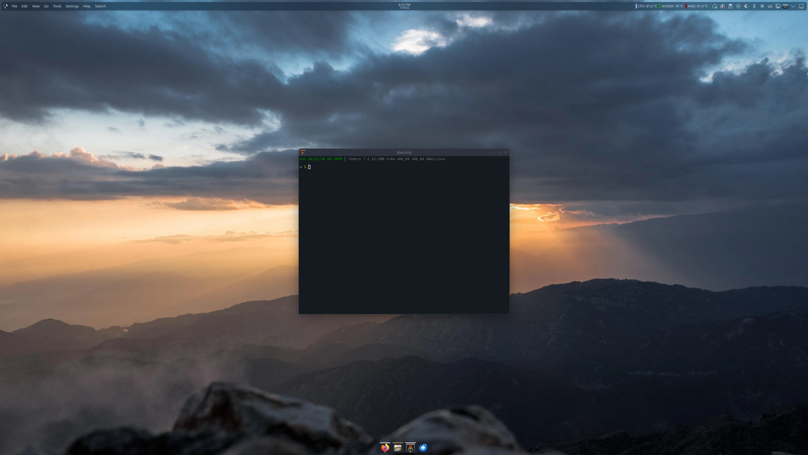

## About

This repository contains all the configuration files and scripts 
I use on my system.
It serves as my starting point whenever I set up a new environment.

Run `bin/cfgload` to initialize.

|Theme|
|-----|
| KDE Plasma |
| [Wallpaper](https://images.hdqwalls.com/download/toros-mountain-in-turkey-4k-wc-3840x2400.jpg)|
| [Font](https://commitmono.com/)|
| [Terminal](https://alacritty.org/)|
| [Neovim Config File](https://github.com/umutsevdi/dotfiles/blob/master/nvim/init.lua)|
| [Tmux Config File](https://github.com/umutsevdi/dotfiles/blob/master/tmux.conf)|
